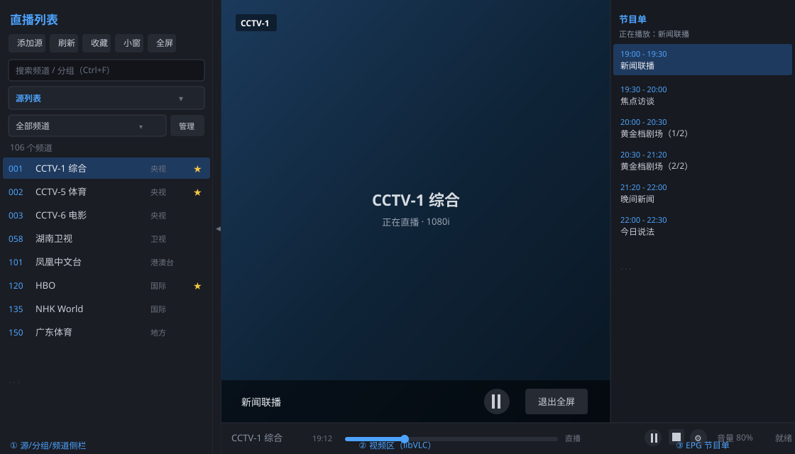

# TiviMateWin

Windows desktop IPTV player built with WPF + libVLC + .NET 8. Portable, no installation required — just unzip and run.

[简体中文](README.md) | English




## Features

- **Multiple playlists**: manage several M3U / M3U8 playlists and Xtream Codes accounts at once, switch with one click
- **Group & channel management**: parses `group-title` automatically; rename/merge groups, hide channels, sort by number or name
- **EPG**: streaming XMLTV parsing with `XmlReader` (low memory footprint for large files), now-playing highlight, collapsible panel
- **Favorites**: star a channel with one click, filter favorites instantly
- **Picture-in-picture**: always-on-top mini window, plus multi-window playback of different channels
- **Dark / light themes**: resource-dictionary based, switches at runtime
- **Bad-source skipping**: automatically skips unusable channels while channel surfing
- **gzip support**: handles gzip-compressed playlist/EPG responses; network requests are cancellable
- **Live search**: `Ctrl+F` searches channels/groups via `ICollectionView.Filter`
- **Fullscreen**: overlay controls auto-hide when the mouse is idle

## Download

Grab the latest `TiviMateWin-win-x64.zip` from [Releases](https://github.com/ciweihaha/TiviMateWin/releases):

1. Unzip to any folder
2. Run `TiviMateWin.exe`

> The build is **self-contained** — no .NET runtime installation needed. Windows 10/11 x64.

## Getting started

1. Click **添加源** (Add source), paste an M3U/M3U8 playlist URL (or pick a local file), or use Xtream API (server / username / password)
2. Double-click a channel to play; click the **★** at the end of a row to favorite; right-click for more actions (PiP, hide, copy URL, etc.)
3. Watch the EPG panel on the right while playing; use the bottom status bar for play/pause, volume and seek

Credentials are encrypted with Windows DPAPI and stored locally in `config.json`. Nothing is uploaded to any server.

## Keyboard shortcuts

| Shortcut | Action |
| --- | --- |
| `Tab` | Collapse / expand sidebar |
| `Ctrl+F` | Focus search box |
| `Esc` | Clear search / exit fullscreen |
| `F` | Toggle fullscreen |
| `↑` / `↓` | Move selection up/down (channel surfing) |
| `Ctrl+↑` / `Ctrl+↓` | Volume up / down |
| `Enter` | Play selected channel; while searching, play first result |
| `Space` | Play / pause |

## Build from source

```powershell
dotnet publish TiviMateWin.csproj -c Release -r win-x64 --self-contained true -o publish
```

Pushing a `v*` tag (e.g. `v1.3.3`) triggers GitHub Actions to build and publish a Release automatically.

## Privacy

- All config, playlists and favorites stay on your machine. No telemetry.
- Xtream credentials are encrypted with DPAPI before being written to disk.

## License

[MIT](LICENSE)

> AI生成
